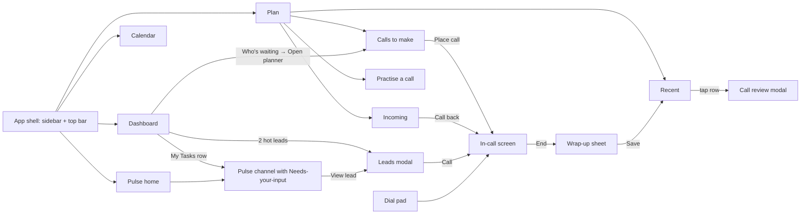
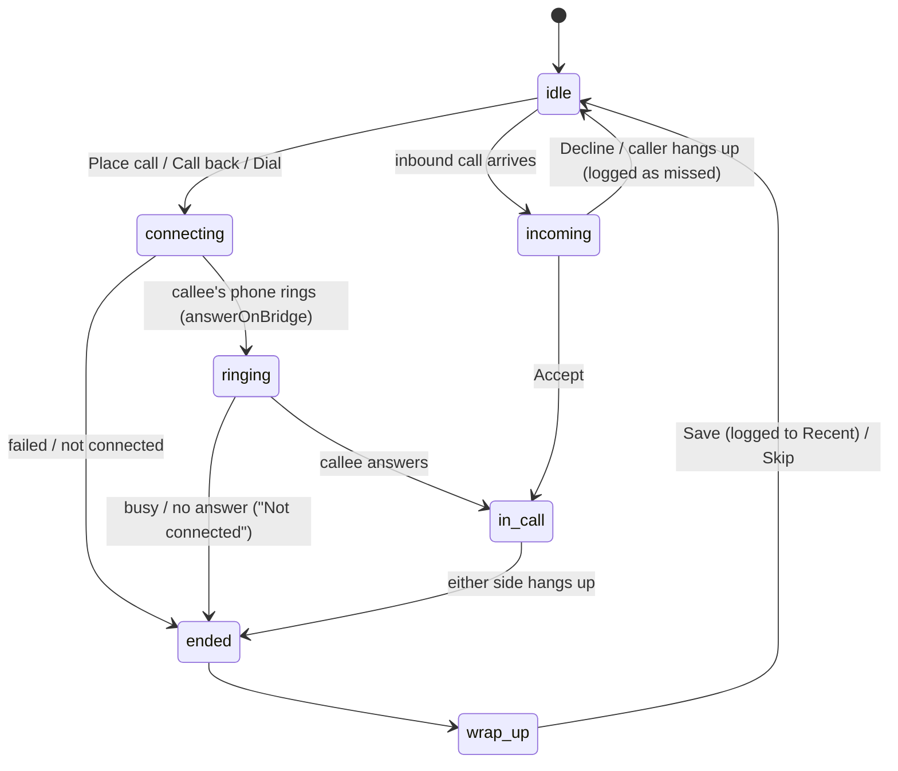
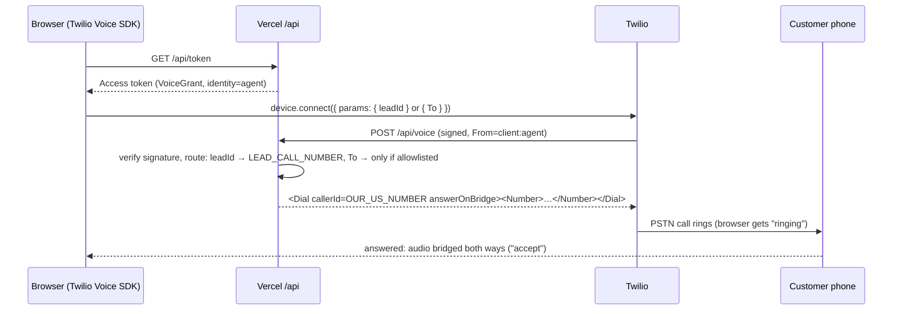
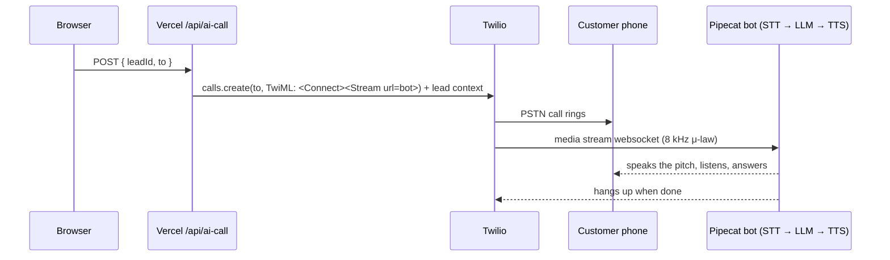

# Flows

How a user moves through the app, and how a call moves through the system.
Update this when a feature changes a flow.

## 1. Screen map

Routes: `/dashboard` (default), `/plan/outgoing`, `/plan/incoming`,
`/plan/recent`, `/plan/practise`, `/calendar`, `/pulse`, `/pulse/:channel`.
Modals (leads, call review, wrap-up, dial pad) are overlays on the current route.

## 2. Call lifecycle (one state machine for every call)

Before any of this, the agent clicks **Go online** (mic permission + device
registration from a user gesture). Offline agents can still place calls, since
registration only matters for inbound.

In `in_call`: mute, keypad (DTMF), live timer, end. One call at a time: a second
outbound is blocked with a message; an inbound call while busy is rejected and
logged as missed.

Call modes, same UI and state machine:

| Mode | Who talks to the customer | Trigger |
|------|---------------------------|---------|
| **Agent call** (human-to-human) | The agent, through the browser mic | Place call, Call back, dial pad |
| **AI call** (AI-to-human) | Pipecat voice bot, with the lead's context | "Let AI call" on a lead |
| **Inbound** | The agent | A customer dials our Twilio number |

## 3. System flow: agent call (browser → real phone)

**Inbound:** the same webhook. When `From` is a phone (not `client:…`),
`/api/voice` answers `<Dial action=/api/voice?dialed=1 timeout=20><Client>agent</Client></Dial>`
and every online browser gets an `incoming` event. The action callback plays
"we'll call you back" only if nobody answered.

## 4. System flow: AI call (AI → real phone)

Bot hosting and the exact stream URL are settled in `docs/` for the AI-calling
feature (see `decisions.md`).

## 5. Pulse "Needs your input"

Dashboard task row → opens its channel → pinned card at top with 2–3 answer
buttons + free-text reply → answering posts "You: <answer>" in the thread,
removes the card, decrements the channel badge and the dashboard task count.

## 6. Data

Sample data is static JSON in `src/data/`. Runtime changes (sent messages,
answered cards, saved call outcomes, real calls placed) live in client state and
`localStorage`, so a reload keeps the demo's history. No database.
