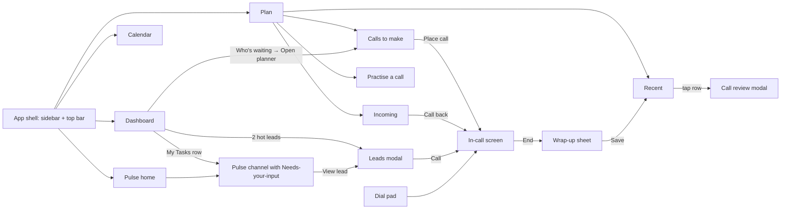
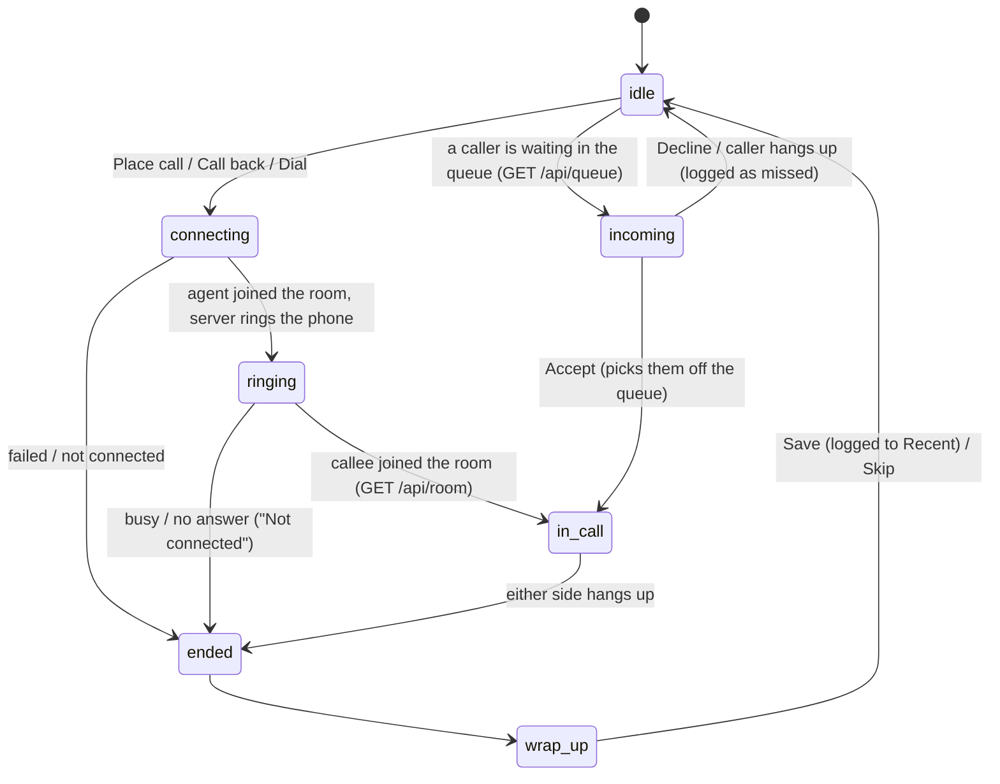
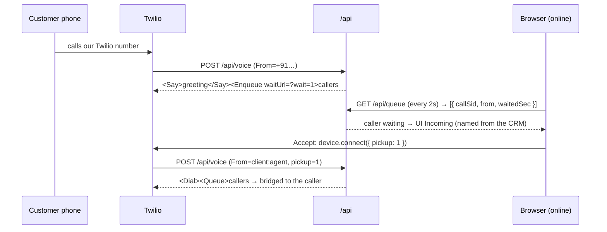
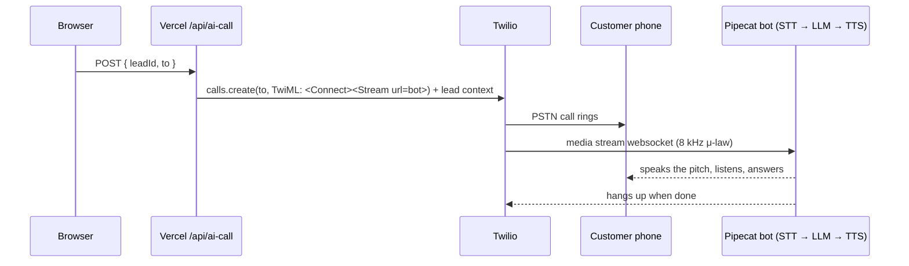

# Flows

How a user moves through the app, and how a call moves through the system.
Update this when a feature changes a flow.

## 1. Screen map



Routes: `/dashboard` (default), `/plan/outgoing`, `/plan/incoming`,
`/plan/recent`, `/plan/practise`, `/calendar`, `/pulse`, `/pulse/:channel`.
Modals (leads, call review, wrap-up, dial pad) are overlays on the current route.

## 2. Call lifecycle (one state machine for every call)



Before receiving calls, the agent clicks **Go online** (mic permission from a
user gesture, then the browser watches the queue). Offline agents can still
place calls.

In `in_call`: mute, keypad (DTMF), live timer, end. One call at a time: a second
outbound is blocked with a message; inbound callers who arrive while the agent
is busy keep waiting in the queue and ring once the agent is free.

Call modes, same UI and state machine:

| Mode | Who talks to the customer | Trigger |
|------|---------------------------|---------|
| **Agent call** (human-to-human) | The agent, through the browser mic | Place call, Call back, dial pad |
| **AI call** (AI-to-human) | Pipecat voice bot, with the lead's context | Not built: needs a paid account (§4) |
| **Inbound** | The agent | A customer dials our Twilio number |

## 3. System flow: agent calls (trial-compatible, D18)

A Twilio trial account strips `<Dial><Number>` and `<Dial><Client>`, so the
browser and the phone are never dialled into each other. They meet in a
conference (outbound) or a queue (inbound). The same code runs on a paid account.

**Outbound (browser → real phone):**

```mermaid
sequenceDiagram
  participant B as Browser (Twilio Voice SDK)
  participant V as /api
  participant T as Twilio
  participant P as Customer phone
  B->>V: GET /api/token
  V-->>B: Access token (VoiceGrant, identity=agent)
  B->>T: device.connect({ leadId } or { To })
  T->>V: POST /api/voice (signed, From=client:agent)
  V->>V: verify signature; leadId → LEAD_CALL_NUMBER, To → only if allowlisted
  V->>T: calls.create(phone, TwiML: join "agent-room", statusCallback ?leg=pstn)
  V-->>T: agent leg: <Dial><Conference statusCallback=?leg=room>agent-room
  T-->>B: "accept": agent is in the room → UI Ringing
  T->>P: phone rings; answered → joins the same room
  B->>V: GET /api/room?agent=CallSid (every 1s) → { connected: true } → UI On call
  Note over V,T: anyone leaves / room ends → ?leg=room callback hangs up both legs
```

**Inbound (real phone → browser):**



Decline posts `{ decline: CallSid }` to `/api/queue`, which redirects that
caller to an apology. A caller nobody answers hears "we'll call you back"
after about 30 seconds of hold.

## 4. System flow: AI call (AI → real phone) · planned, not built

Needs a paid Twilio account: trial strips `<Stream>`, which carries the call
audio to the bot. The design, kept for when the account is upgraded:



Bot hosting and the exact stream URL are in `docs/07-ai-calling.md` (D13).

## 5. Pulse "Needs your input"

Dashboard task row → opens its channel → pinned card at top with 2–3 answer
buttons + free-text reply → answering posts "You: <answer>" in the thread,
removes the card, decrements the channel badge and the dashboard task count.

## 6. Data

Sample data is static JSON in `src/data/`. Runtime changes (sent messages,
answered cards, saved call outcomes, real calls placed) live in client state and
`localStorage`, so a reload keeps the demo's history. No database.
